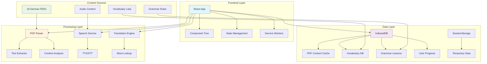
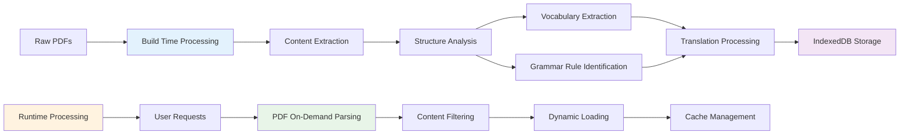
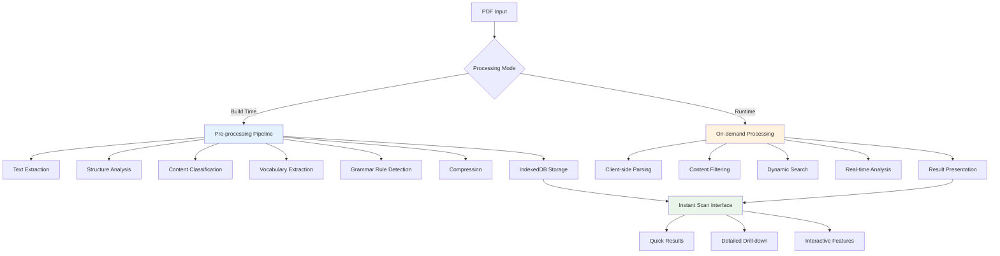
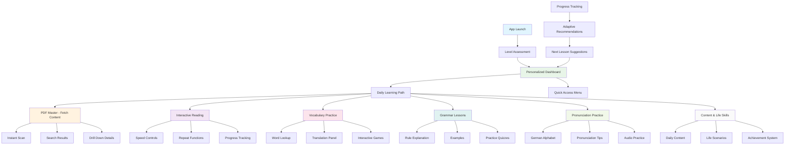

# German Learning App - Comprehensive Technical Architecture Plan

## Overview

This document outlines the complete technical architecture for transforming the existing IELTS preparation app into a comprehensive German learning platform with PDF processing, interactive reading, vocabulary system, grammar lessons, and pronunciation features.

## Table of Contents

1. [System Architecture](#system-architecture)
2. [Data Structure & Processing Pipeline](#data-structure--processing-pipeline)
3. [Component Architecture](#component-architecture)
4. [State Management](#state-management)
5. [Performance Optimization](#performance-optimization)
6. [PDF Processing Workflow](#pdf-processing-workflow)
7. [Interactive Features Implementation](#interactive-features-implementation)
8. [User Experience Flow](#user-experience-flow)
9. [Testing & Validation](#testing--validation)

---

## System Architecture

### High-Level Architecture



### Component Hierarchy

```mermaid
graph TD
    A[App] --> B[Navigation]
    A --> C[Main Routes]
    
    C --> D[PDF Master]
    C --> E[Interactive Reading]
    C --> F[Vocabulary System]
    C --> G[Grammar Lessons]
    C --> H[Pronunciation Hub]
    C --> I[Content & Life]
    
    D --> D1[PDF Viewer]
    D --> D2[Search Interface]
    D --> D3[Quick Scanner]
    D --> D4[Drill Down Panel]
    
    E --> E1[Text Display]
    E --> E2[Speed Controls]
    E --> E3[Repeat Controls]
    E --> E4[Progress Tracker]
    
    F --> F1[Word Lookup]
    F --> F2[Translation Panel]
    F --> F3[Vocab Games]
    F --> F4[Progress Tracking]
    
    G --> G1[Rule Display]
    G --> G2[Examples Section]
    G --> G3[Quiz Engine]
    G --> G4[Progress Monitor]
    
    H --> H1[German Alphabet]
    H --> H2[Pronunciation Guide]
    H --> H3[Audio Practice]
    H --> H4[Tips Repository]
    
    I --> I1[Daily Content]
    I --> I2[Life Scenarios]
    I --> I3[Progress Dashboard]
    I --> I4[Achievement System]
    
    style A fill:#e1f5fe
    style D fill:#fff3e0
    style E fill:#e8f5e8
    style F fill:#f3e5f5
    style G fill:#e0f2f1
    style H fill:#fce4ec
    style I fill:#f1f8e9
```



---

## Data Structure & Processing Pipeline

### Data Models

```typescript
// PDF Content Model
interface PDFContent {
  id: string;
  title: string;
  level: 'A1' | 'A2' | 'B1' | 'B2' | 'C1';
  category: 'vocabulary' | 'grammar' | 'reading' | 'culture';
  pages: PDFPage[];
  metadata: {
    wordCount: number;
    difficulty: number;
    topics: string[];
    lastAccessed: Date;
  };
}

interface PDFPage {
  pageNumber: number;
  content: string;
  images: ImageData[];
  tables: TableData[];
  exercises: Exercise[];
}

// Vocabulary Model
interface VocabularyEntry {
  id: string;
  german: string;
  english: string;
  arabic: string;
  pronunciation: string;
  audio?: string;
  examples: Example[];
  level: string;
  category: string;
  mastery: number; // 0-100
  lastReviewed: Date;
}

// Grammar Rule Model
interface GrammarRule {
  id: string;
  title: string;
  level: string;
  category: string;
  explanation: string;
  examples: Example[];
  exercises: Exercise[];
  tips: string[];
}

// User Progress Model
interface UserProgress {
  userId: string;
  currentLevel: string;
  vocabularyProgress: { [wordId: string]: number };
  grammarProgress: { [ruleId: string]: ExerciseResult };
  readingProgress: { [contentId: string]: ReadingProgress };
  pronunciationProgress: { [soundId: string]: PronunciationScore };
  dailyStreak: number;
  totalStudyTime: number;
  achievements: Achievement[];
}
```

### Processing Pipeline



---

## Component Architecture

### Core Components Structure

```typescript
// Main App Structure
src/
├── components/
│   ├── shared/
│   │   ├── Layout/
│   │   ├── Navigation/
│   │   ├── LoadingSpinner/
│   │   └── ErrorBoundary/
│   ├── pdf/
│   │   ├── PDFViewer/
│   │   ├── SearchInterface/
│   │   ├── QuickScanner/
│   │   └── DrillDownPanel/
│   ├── reading/
│   │   ├── TextDisplay/
│   │   ├── SpeedControls/
│   │   ├── RepeatControls/
│   │   └── ProgressTracker/
│   ├── vocabulary/
│   │   ├── WordLookup/
│   │   ├── TranslationPanel/
│   │   ├── VocabGames/
│   │   └── ProgressTracking/
│   ├── grammar/
│   │   ├── RuleDisplay/
│   │   ├── ExamplesSection/
│   │   ├── QuizEngine/
│   │   └── ProgressMonitor/
│   ├── pronunciation/
│   │   ├── AlphabetGuide/
│   │   ├── PronunciationGuide/
│   │   ├── AudioPractice/
│   │   └── TipsRepository/
│   └── content/
│       ├── DailyContent/
│       ├── LifeScenarios/
│       ├── ProgressDashboard/
│       └── AchievementSystem/
├── hooks/
│   ├── usePDFProcessor.ts
│   ├── useVocabulary.ts
│   ├── useGrammar.ts
│   ├── usePronunciation.ts
│   ├── useSpeechSynthesis.ts
│   ├── useSpeechRecognition.ts
│   └── useProgressTracking.ts
├── services/
│   ├── pdfService.ts
│   ├── vocabularyService.ts
│   ├── grammarService.ts
│   ├── pronunciationService.ts
│   ├── progressService.ts
│   └── storageService.ts
├── utils/
│   ├── textProcessing.ts
│   ├── speechUtils.ts
│   ├── compression.ts
│   └── performance.ts
└── data/
    ├── processed-content/
    ├── vocabulary/
    ├── grammar/
    └── audio/
```

---

## State Management

### State Structure

```typescript
interface AppState {
  // User & Progress
  user: UserState;
  progress: ProgressState;
  
  // Content
  pdfs: PDFState;
  vocabulary: VocabularyState;
  grammar: GrammarState;
  pronunciation: PronunciationState;
  
  // UI State
  ui: UIState;
  navigation: NavigationState;
  
  // Performance
  performance: PerformanceState;
}

interface UserState {
  currentLevel: 'A1' | 'A2' | 'B1' | 'B2' | 'C1';
  preferences: UserPreferences;
  achievements: Achievement[];
  studyStreak: number;
}

interface PDFState {
  loadedPdfs: { [id: string]: PDFContent };
  currentPdf: string | null;
  searchQuery: string;
  searchResults: SearchResult[];
  quickScanResults: QuickScanResult[];
  drillDownContent: any;
}

interface VocabularyState {
  lookupHistory: VocabularyEntry[];
  currentTranslations: { [germanWord: string]: Translation };
  vocabularProgress: { [wordId: string]: number };
  dailyWords: VocabularyEntry[];
  games: VocabGameState;
}
```

### State Management Implementation

```typescript
// Using React Context + useReducer for complex state
const AppContext = createContext<AppState | null>(null);

function appReducer(state: AppState, action: AppAction): AppState {
  switch (action.type) {
    case 'LOAD_PDF':
      return {
        ...state,
        pdfs: {
          ...state.pdfs,
          loadedPdfs: {
            ...state.pdfs.loadedPdfs,
            [action.payload.id]: action.payload
          }
        }
      };
    
    case 'UPDATE_VOCAB_PROGRESS':
      return {
        ...state,
        vocabulary: {
          ...state.vocabulary,
          vocabularProgress: {
            ...state.vocabulary.vocabularProgress,
            [action.payload.wordId]: action.payload.progress
          }
        }
      };
    
    // ... other actions
  }
}
```

---

## Performance Optimization

### Performance Strategies

```mermaid
graph TB
    A[Performance Optimization] --> B[Loading Strategy]
    A --> C[Memory Management]
    A --> D[Rendering Optimization]
    A --> E[Storage Optimization]
    
    B --> B1[Lazy Loading]
    B --> B2[Code Splitting]
    B --> B3[Progressive Loading]
    B --> B4[Preloading]
    
    C --> C1[Virtual Scrolling]
    C --> C2[Memory Cleanup]
    C --> C3[Cache Management]
    C --> C4[Garbage Collection]
    
    D --> D1[React.memo]
    D --> D2[useMemo/useCallback]
    D --> D3[Component Pooling]
    D --> D4[Optimistic Updates]
    
    E --> E1[Data Compression]
    E --> E2[IndexedDB Optimization]
    E --> E3[Service Worker Caching]
    E --> E4[Background Sync]
    
    style A fill:#e1f5fe
    style B fill:#fff3e0
    style C fill:#e8f5e8
    style D fill:#f3e5f5
    style E fill:#fce4ec
```



### Implementation Details

```typescript
// Lazy loading components
const PDFViewer = lazy(() => import('./components/pdf/PDFViewer'));
const VocabularySystem = lazy(() => import('./components/vocabulary/VocabularySystem'));

// Virtual scrolling for large content
const VirtualizedList = ({ items, itemHeight }) => {
  const [visibleRange, setVisibleRange] = useState({ start: 0, end: 20 });
  
  return (
    <div style={{ height: '400px', overflow: 'auto' }}>
      <div style={{ height: items.length * itemHeight }}>
        {items.slice(visibleRange.start, visibleRange.end).map(renderItem)}
      </div>
    </div>
  );
};

// Memory-efficient PDF processing
class PDFProcessor {
  private chunkSize = 1024 * 1024; // 1MB chunks
  private processingQueue: Queue<PDFChunk> = new Queue();
  
  async processLargePDF(pdfFile: File): Promise<PDFContent> {
    const chunks = this.splitPDFIntoChunks(pdfFile);
    const results = [];
    
    for (const chunk of chunks) {
      const result = await this.processChunk(chunk);
      results.push(result);
      
      // Allow UI to breathe
      await this.yieldToMainThread();
    }
    
    return this.mergeResults(results);
  }
}
```

---

## PDF Processing Workflow

### Hybrid Processing Approach



### Implementation Strategy

```typescript
// PDF Service Implementation
class PDFService {
  private db: IDBDatabase;
  
  async initialize(): Promise<void> {
    this.db = await this.openIndexedDB();
  }
  
  // Build-time processing (pre-processing)
  async preProcessPDF(pdfFile: File): Promise<ProcessedPDF> {
    const pdfData = await this.extractText(pdfFile);
    const structure = await this.analyzeStructure(pdfData);
    const vocabulary = await this.extractVocabulary(pdfData);
    const grammarRules = await this.detectGrammarRules(pdfData);
    
    return {
      id: generateId(),
      content: pdfData,
      structure,
      vocabulary,
      grammarRules,
      metadata: this.generateMetadata(pdfData)
    };
  }
  
  // Runtime processing (on-demand)
  async processOnDemand(pdfFile: File, query?: string): Promise<ProcessedPDF> {
    const chunks = this.splitIntoChunks(pdfFile);
    const results = [];
    
    for (const chunk of chunks) {
      if (query) {
        const filtered = await this.searchInChunk(chunk, query);
        results.push(filtered);
      } else {
        results.push(chunk);
      }
      
      // Progress callback for UI updates
      this.onProgress(results.length / chunks.length);
    }
    
    return this.combineResults(results);
  }
  
  // Instant scan for ultra-compact first reply
  async quickScan(pdfFile: File): Promise<QuickScanResult> {
    const firstPages = await this.extractFirstPages(pdfFile, 3);
    const summary = await this.generateSummary(firstPages);
    const keywords = await this.extractKeywords(firstPages);
    const difficulty = await this.assessDifficulty(firstPages);
    
    return {
      summary,
      keywords,
      difficulty,
      estimatedReadTime: this.estimateReadTime(firstPages),
      recommendedLevel: this.recommendLevel(difficulty)
    };
  }
}
```

---

## Interactive Features Implementation

### Interactive Reading Module

```typescript
interface ReadingSession {
  content: string;
  currentPosition: number;
  speed: number; // words per minute
  repeatCount: number;
  isPlaying: boolean;
  userProgress: ReadingProgress;
}

class InteractiveReadingManager {
  private session: ReadingSession;
  private speechEngine: SpeechSynthesis;
  private progressTracker: ProgressTracker;
  
  startReading(content: string, options: ReadingOptions): void {
    this.session = {
      content,
      currentPosition: 0,
      speed: options.speed || 150,
      repeatCount: 0,
      isPlaying: false,
      userProgress: { wordsRead: 0, comprehensionScore: 0 }
    };
    
    this.initializeControls();
    this.startSpeechSynthesis();
  }
  
  private startSpeechSynthesis(): void {
    const utterance = new SpeechSynthesisUtterance();
    utterance.rate = this.session.speed / 150; // Normalize to 150 WPM baseline
    utterance.onboundary = (event) => {
      this.updatePosition(event.charIndex);
      this.highlightCurrentWord(event.charIndex);
    };
    
    utterance.text = this.session.content;
    this.speechEngine.speak(utterance);
  }
  
  adjustSpeed(newSpeed: number): void {
    this.session.speed = newSpeed;
    this.restartCurrentSentence();
  }
  
  repeatCurrentSection(): void {
    const currentSentence = this.getCurrentSentence();
    this.speakText(currentSentence);
  }
}
```

### Vocabulary System

```typescript
class VocabularySystem {
  private translationCache: Map<string, Translation> = new Map();
  
  async lookupWord(germanWord: string): Promise<VocabularyEntry> {
    // Check cache first
    if (this.translationCache.has(germanWord)) {
      return this.translationCache.get(germanWord)!;
    }
    
    // Check local database
    const localResult = await this.searchLocalDatabase(germanWord);
    if (localResult) {
      this.translationCache.set(germanWord, localResult);
      return localResult;
    }
    
    // Generate translation if not found
    const translation = await this.generateTranslation(germanWord);
    this.translationCache.set(germanWord, translation);
    
    return translation;
  }
  
  private async generateTranslation(word: string): Promise<VocabularyEntry> {
    // Use German-English and German-Arabic translation logic
    const english = await this.translateToEnglish(word);
    const arabic = await this.translateToArabic(word);
    const pronunciation = await this.getPronunciation(word);
    
    return {
      id: generateId(),
      german: word,
      english,
      arabic,
      pronunciation,
      examples: await this.generateExamples(word),
      level: await this.assessLevel(word),
      category: await this.categorizeWord(word)
    };
  }
  
  // Interactive vocabulary games
  startVocabGame(gameType: 'matching' | 'quiz' | 'flashcards'): void {
    const gameEngine = new VocabGameEngine(gameType);
    gameEngine.initialize(this.getUserVocabularLevel());
    gameEngine.start();
  }
}
```

### Grammar Lessons with Quizzes

```typescript
interface GrammarLesson {
  rule: GrammarRule;
  examples: Example[];
  exercises: Exercise[];
  userProgress: LessonProgress;
}

class GrammarLessonManager {
  async loadLesson(ruleId: string): Promise<GrammarLesson> {
    const rule = await this.getGrammarRule(ruleId);
    const examples = await this.getRelevantExamples(rule);
    const exercises = await this.generateExercises(rule);
    
    return {
      rule,
      examples,
      exercises,
      userProgress: await this.getUserProgress(ruleId)
    };
  }
  
  async processAnswer(exerciseId: string, userAnswer: string): Promise<AnswerResult> {
    const exercise = await this.getExercise(exerciseId);
    const isCorrect = this.evaluateAnswer(exercise, userAnswer);
    const feedback = await this.generateFeedback(exercise, userAnswer, isCorrect);
    
    // Update progress
    await this.updateProgress(exerciseId, isCorrect, userAnswer);
    
    return {
      isCorrect,
      feedback,
      correctAnswer: exercise.correctAnswer,
      explanation: feedback.explanation
    };
  }
  
  private generateExercises(rule: GrammarRule): Exercise[] {
    // Rule explanation → practice pattern
    const exercises = [];
    
    // 1. Rule identification exercise
    exercises.push({
      id: generateId(),
      type: 'rule_identification',
      question: `Which grammar rule applies to: "${rule.examples[0].sentence}"?`,
      options: this.getRuleOptions(rule),
      correctAnswer: rule.id
    });
    
    // 2. Application exercise
    exercises.push({
      id: generateId(),
      type: 'application',
      question: `Apply the rule to: "${rule.examples[1].sentence}"`,
      correctAnswer: rule.examples[1].corrected,
      hint: rule.tips[0]
    });
    
    // 3. Multiple choice
    exercises.push({
      id: generateId(),
      type: 'multiple_choice',
      question: rule.explanation,
      options: [rule.explanation, ...this.generateDistractors(rule)],
      correctAnswer: 0
    });
    
    return exercises;
  }
}
```

---

## User Experience Flow

### Learning Path Flow



### Adaptive Learning Algorithm

```typescript
class AdaptiveLearningEngine {
  private userModel: UserModel;
  private contentRecommender: ContentRecommender;
  
  async updateUserModel(interaction: UserInteraction): Promise<void> {
    // Update user's knowledge state
    this.userModel.updateKnowledge(interaction);
    
    // Calculate next recommended content
    const recommendations = await this.contentRecommender.getRecommendations(
      this.userModel.getCurrentState(),
      this.getAvailableContent()
    );
    
    // Update dashboard with new recommendations
    this.updateDashboard(recommendations);
  }
  
  private getRecommendations(): LearningRecommendation[] {
    const weakAreas = this.identifyWeakAreas();
    const strongAreas = this.identifyStrongAreas();
    
    return [
      // Focus on weak areas with easier content
      ...weakAreas.map(area => ({
        type: 'practice',
        content: this.getAppropriateContent(area, 'easy'),
        reason: `Strengthen ${area} skills`
      })),
      
      // Challenge strong areas
      ...strongAreas.map(area => ({
        type: 'challenge',
        content: this.getAppropriateContent(area, 'hard'),
        reason: `Master advanced ${area} concepts`
      })),
      
      // Spaced repetition for vocabulary
      ...this.getVocabularyReviewItems().map(item => ({
        type: 'review',
        content: item,
        reason: `Review previously learned vocabulary`
      }))
    ];
  }
}
```

---

## Testing & Validation

### Testing Strategy

```mermaid
graph TB
    A[Testing Strategy] --> B[Unit Tests]
    A --> C[Integration Tests]
    A --> D[E2E Tests]
    A --> E[Performance Tests]
    A --> F[Accessibility Tests]
    
    B --> B1[Component Tests]
    B --> B2[Hook Tests]
    B --> B3[Service Tests]
    B --> B4[Utility Tests]
    
    C --> C1[PDF Processing]
    C --> C2[Speech Integration]
    C --> C3[State Management]
    C --> C4[Storage Operations]
    
    D --> D1[User Journeys]
    D --> D2[Feature Workflows]
    D --> D3[Cross-browser]
    D --> D4[Mobile Responsive]
    
    E --> E1[Load Testing]
    E --> E2[Memory Usage]
    E --> E3[Rendering Performance]
    E --> E4[Search Performance]
    
    F --> F1[Screen Reader]
    F --> F2[Keyboard Navigation]
    F --> F3[Color Contrast]
    F --> F4[Voice Control]
    
    style A fill:#e1f5fe
    style B fill:#fff3e0
    style C fill:#e8f5e8
    style D fill:#f3e5f5
    style E fill:#fce4ec
    style F fill:#f1f8e9
```



### Test Implementation

```typescript
// Example test structure
describe('PDF Processing Pipeline', () => {
  test('should extract text from German PDF correctly', async () => {
    const pdfFile = createMockPDFFile();
    const processor = new PDFService();
    
    const result = await processor.processOnDemand(pdfFile, 'Grammatik');
    
    expect(result.text).toContain('Grammatik');
    expect(result.metadata.wordCount).toBeGreaterThan(0);
    expect(result.vocabulary).toHaveLength.greaterThan(0);
  });
  
  test('should provide instant scan results quickly', async () => {
    const pdfFile = createLargePDFFile();
    const processor = new PDFService();
    
    const startTime = Date.now();
    const result = await processor.quickScan(pdfFile);
    const endTime = Date.now();
    
    expect(endTime - startTime).toBeLessThan(2000); // Under 2 seconds
    expect(result.summary).toBeDefined();
    expect(result.keywords).toHaveLength.greaterThan(0);
  });
});

describe('Interactive Reading Module', () => {
  test('should adjust reading speed correctly', () => {
    const readingManager = new InteractiveReadingManager();
    readingManager.startReading(testContent, { speed: 150 });
    
    readingManager.adjustSpeed(200);
    
    expect(readingManager.getCurrentSpeed()).toBe(200);
  });
  
  test('should track reading progress accurately', () => {
    const readingManager = new InteractiveReadingManager();
    readingManager.startReading(testContent);
    
    // Simulate reading progression
    readingManager.simulateReading(50); // 50 words
    
    const progress = readingManager.getProgress();
    expect(progress.wordsRead).toBe(50);
    expect(progress.comprehensionScore).toBeGreaterThanOrEqual(0);
  });
});
```

---

## Implementation Timeline

### Phase 1: Core Infrastructure (Weeks 1-2)
- [ ] Set up new navigation structure
- [ ] Implement PDF processing pipeline
- [ ] Create IndexedDB schema and storage services
- [ ] Build core state management system
- [ ] Implement basic PDF viewer

### Phase 2: Interactive Reading (Weeks 3-4)
- [ ] Develop speed/repeat controls
- [ ] Implement speech synthesis integration
- [ ] Create progress tracking system
- [ ] Build responsive text display components

### Phase 3: Vocabulary System (Weeks 5-6)
- [ ] Implement word lookup functionality
- [ ] Create translation panel with Arabic/English
- [ ] Build vocabulary games
- [ ] Implement spaced repetition algorithm

### Phase 4: Grammar Lessons (Weeks 7-8)
- [ ] Create rule explanation components
- [ ] Implement quiz engine
- [ ] Build interactive exercises
- [ ] Create progress monitoring system

### Phase 5: Pronunciation Module (Weeks 9-10)
- [ ] Implement German alphabet guide
- [ ] Create pronunciation tips repository
- [ ] Build audio practice features
- [ ] Integrate speech recognition

### Phase 6: Content & Life Learning (Weeks 11-12)
- [ ] Create daily content system
- [ ] Implement life scenario modules
- [ ] Build achievement system
- [ ] Create comprehensive dashboard

### Phase 7: Optimization & Testing (Weeks 13-14)
- [ ] Performance optimization
- [ ] Cross-browser testing
- [ ] Mobile responsiveness
- [ ] Accessibility compliance
- [ ] User testing and refinements

---

## Technical Specifications

### Dependencies
```json
{
  "dependencies": {
    "react": "^18.3.1",
    "react-dom": "^18.3.1",
    "react-router-dom": "^6.21.0",
    "lucide-react": "^0.294.0",
    "pdfjs-dist": "^3.11.174",
    "dexie": "^3.2.4",
    "lz-string": "^1.5.0",
    "fuse.js": "^7.0.0"
  },
  "devDependencies": {
    "@types/react": "^18.3.12",
    "@types/react-dom": "^18.3.1",
    "@vitejs/plugin-react": "^4.3.4",
    "vite": "^5.4.11",
    "eslint": "^8.55.0",
    "vitest": "^1.0.0",
    "@testing-library/react": "^13.4.0",
    "@testing-library/jest-dom": "^6.1.0"
  }
}
```

### Performance Targets
- PDF scan response: < 2 seconds
- Interactive reading startup: < 1 second
- Vocabulary lookup: < 500ms
- Grammar quiz loading: < 1 second
- Mobile performance: 60 FPS
- Memory usage: < 100MB for typical session
- Bundle size: < 2MB initial, < 5MB total

### Browser Support
- Chrome 90+
- Firefox 88+
- Safari 14+
- Edge 90+
- Mobile browsers with Web Speech API support

---

This architecture plan provides a comprehensive foundation for building a scalable, performant German learning application that meets all the specified requirements while maintaining high user experience standards.